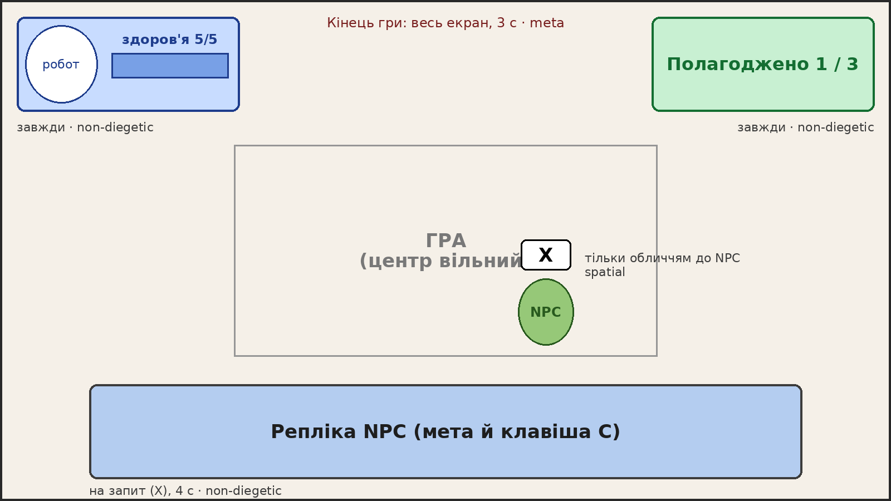

# HUD зрізу: що гравець має знати

Таблиця й макет до розділу «Індикатори стану (HUD)». Реалізація в грі: Assets/UI/GameUI.uxml.

| Що гравець має знати | Коли | Вид і місце |
|---|---|---|
| Здоров'я робота (з 5) | завжди | non-diegetic: смуга з портретом у лівому верхньому куті |
| Полагоджено N / 3 | завжди | non-diegetic: лічильник у правому верхньому куті |
| Мета від NPC: полагодити всіх, обходити паливо, клавіша C | на запит (X біля NPC), 4 с | non-diegetic: вікно репліки внизу екрана |
| Що з NPC можна поговорити, і клавіша X | лише коли робот стоїть обличчям до NPC | spatial: бульбашка з X над NPC |
| Перемога або поразка | у момент події, 3 с до перезапуску | meta: весь екран |

## Макет 16:9

## Перевірка себе
- Центр екрана вільний: там гра.
- «Завжди» лише двічі (здоров'я й лічильник), решта має свій момент.
- Здоров'я передає ширина смуги й портрет, а не тільки колір.
